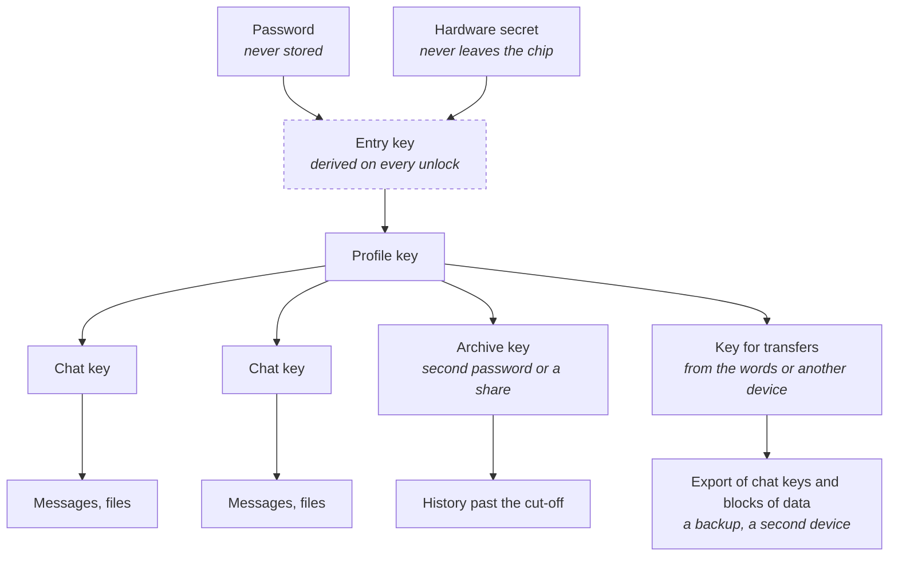

# LetheWis

A Rust library for the lifecycle of encryption keys on a device that may be taken from its owner:

- key derivation from a password, from a recovery phrase, and from a hardware secret;
- a key hierarchy with per-key state and versioning;
- destruction of a single key or of a whole profile;
- recovery independent of the hardware, and detection of a lost key;
- conditional access: key shares held by other people, and a time lock.

It is for applications where seizure is part of the threat model: wallets, password managers, notes,
tools for crossing a border, evidence collection. Properties that can be stated precisely are proven
formally wherever that is possible; what cannot be proven is measured on real devices and described
as measured. The core is platform-independent and builds without the standard library and without a
memory allocator; hardware binding is a crate of its own for each platform, Android first.
Suggestions for functionality not listed here are accepted as issues.

## How the keys relate

A key is never alone: each one opens only the level below it. Destroying one link makes everything
under it unreadable and leaves the rest untouched: deleting a chat destroys that chat's key, and
nothing else. The entry key is dashed because it is not stored anywhere: it is derived from the
password and the hardware secret at each unlock, and neither alone is enough.

## What is not guaranteed

- A destroyed key is gone only after the epoch change is committed and the hardware erases the old
  root. If that root survives or the hardware's keys leak, old records may still open.
- A key derived from a password, twelve words or two shares comes back from them. Destroying it
  does not reach them; destroying the profile key it opens does.
- An export outlives later changes on the device: its key for transfers opens it in any epoch. No
  export tells its age, so an older backup opens as a newer one does.
- A lock record left behind opens until the next change of epoch. Against someone who held that
  epoch's key and the record's secret, only a new profile key helps.
- A changed public key of an archive key is found only at its next load. Batches archived before
  that go to the changed key, and only someone who already reads those chats can change it.
- The archive keeps batches secret but does not prove where they came from. Against whoever holds
  the main password, their secrecy rests on the random source at archiving.
- A block of data or a batch shows its length; padding and the list of blocks are the caller's.
  An older block put back, or one deleted, goes unnoticed unless the caller's index catches it.
- A challenge to the chip is as sensitive as a hash of the password. Whoever reads one can test
  guesses without the chip; keeping it to the chip and wiping it is the caller's.
- Wiping does not reach copies left by a move, a reallocation, a register, swap or a crash dump.
  Every call that derives, encrypts or runs X-Wing wipes its stack, measured on Linux.
- The stack a call needs is not measured on microcontrollers, where an unguarded overflow corrupts
  memory silently. Each call documents the least it needs; a derivation from a password also needs
  64 MiB of memory.
- The cost of a derivation from a password is the caller's, past a floor of 64 MiB and 3 passes.
  So is bringing typed text into one Unicode form.
- A key handed out is the caller's to wipe. Only a key for external data leaves in the clear,
  through `Slots::reveal32`.
- Keys for wrapping and for transfers leave in the clear only as words or shares of a generation.
  Keeping them is the caller's.
- A broken random source is covered in part, by hedging with the epoch key per RFC 8937. Not
  covered: an epoch key from that source, a copied process or machine, repeats across `Slots`, and
  password salts.
- Twelve words are as safe as the place they are kept: whoever reads them derives the key. Keeping
  them off screenshots, the clipboard and backups is the caller's.
- About one changed word in sixteen passes the checksum; the key it gives opens no record.
- A share with four or more wrong words may pass its check of three words. The check of the secret
  still refuses it, but for one time in 2^32.
- Any two holders of shares open what the shares protect, agreeing, forced or deceived. One alone
  learns nothing.
- A changed share is refused, not named. A 4-byte check split with the secret catches a change,
  except once in 2^32.
- A dedicated secure element is missing on a large share of Android devices, by our estimate.
  There protection falls back and records the level it reached.
- A device unlocked since boot has its keys in memory already. No key-storage library changes
  that, and a lock screen is no defence against someone holding such a device.
- A proof is about one named statement, not about safety. Each claim names the tool, its version,
  the assumptions and what is not covered, and never says "formally verified" alone.

The full statement of what is and is not defended, with the assumptions behind each:
[docs/threat-model.md](docs/threat-model.md).

## Crates

Split along the boundary of what is proven: anything that reaches the system or the network is a
separate crate, so the proof perimeter is visible from the directory listing.

| Crate | Contents |
|---|---|
| `lethewis-core` | derivation, hierarchy, lifecycle, destruction, two-tier access, key shares, data in blocks; no network or clock, the system only through `lethewis-dit` |
| `lethewis-dit` | data-independent timing on aarch64 for a piece of work, where Linux, Android or an Apple system reports it; the one crate with unsafe code |

Hardware binding and the time lock will each be a crate of its own, listed here when it exists.

Claimed and proven properties: [docs/proofs.md](docs/proofs.md).

Minimum supported Rust version: 1.99, as declared in the manifest; newer compilers work. A raise is
recorded in [CHANGELOG.md](CHANGELOG.md).

This repository builds with exactly 1.99.0, pinned in `rust-toolchain.toml` so that builds reproduce
byte for byte. The pin is not part of the published package.

How dependencies are reviewed, and which versions a dependent receives:
[SECURITY.md](SECURITY.md#dependencies).

## Reporting and contributing

Report a security problem through the private advisory form, not as a public issue. Terms and
timings are in [SECURITY.md](SECURITY.md).

Bugs, problems with a proof and requests for functionality go in issues. A property that does not
hold is the most useful report this project can get.

Code is not accepted yet, for the reasons in [CONTRIBUTING.md](CONTRIBUTING.md); describe the fix in
an issue instead. The code of conduct is in [CODE_OF_CONDUCT.md](CODE_OF_CONDUCT.md).

## Licence

[GNU AGPL v3 only](LICENSE). The English word list of BIP 39 in
`crates/lethewis-core/src/words/english.txt` is under the
[MIT licence](crates/lethewis-core/LICENSE-MIT), and its notice goes with any build that holds it.

A commercial licence without the AGPL's obligations is available from <hi@alanwisper.com>.
