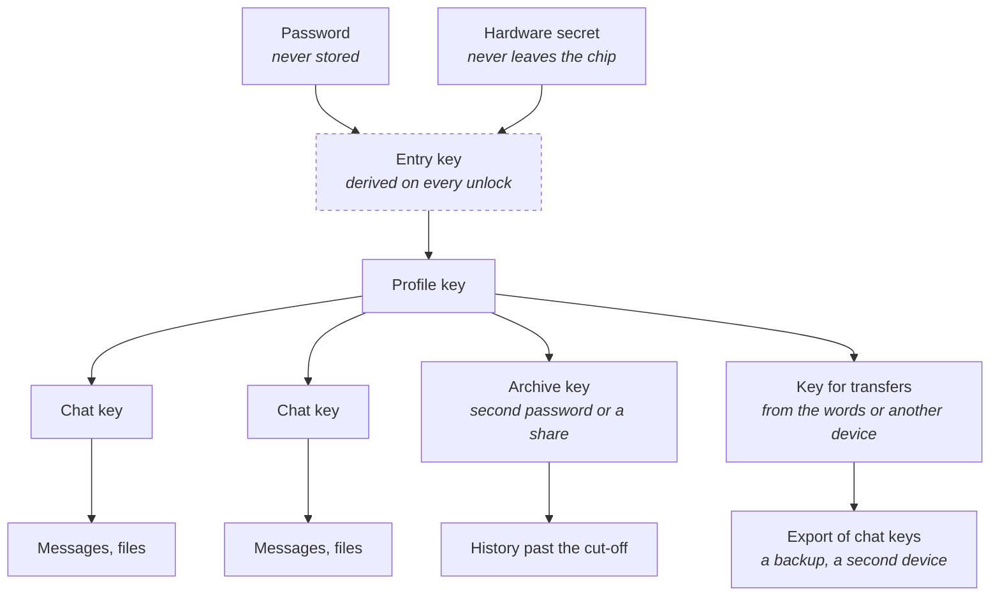

# LetheWis

A Rust library for the lifecycle of encryption keys on a device that may be taken from its owner:

- key derivation from a password, from a recovery phrase, and from a hardware secret;
- a key hierarchy with per-key state and versioning;
- destruction of a single key or of a whole profile;
- recovery independent of the hardware, and detection of a lost key;
- conditional access: key shares held by other people, and a time lock.

It is for applications where seizure is part of the threat model: wallets, password managers, notes,
tools for crossing a border, evidence collection. Properties that can be stated precisely are proven
formally wherever that is possible; what cannot be proven is measured on real devices and described
as measured. The core is platform-independent and builds without the standard library and without a
memory allocator; hardware binding is a crate of its own for each platform, Android first.
Suggestions for functionality not listed here are accepted as issues.

## How the keys relate

A key is never alone: each one opens only the level below it. Destroying one link makes everything
under it unreadable and leaves the rest untouched: deleting a chat destroys that chat's key, and
nothing else. The entry key is dashed because it is not stored anywhere: it is derived from the
password and the hardware secret at each unlock, and neither alone is enough.

## What is not guaranteed

- **A destroyed key is gone once the epoch change is committed and the hardware erases the old
  root.** Records of the old epoch, on flash or in an earlier copy of the device, then no longer open,
  unless the hardware's own keys leak. Without such a root a destroyed key is most likely gone, not
  certainly.
- **A key derived from a password or from twelve words comes back from them.** Destroying it does
  not reach the password or the words; destroying the profile key it opens does.
- **An export outlives what happens on the device after it.** Its records open with its key for
  transfers in any epoch, so destroying a chat or the profile does not reach an export made before.
  No export tells its age: an older backup under the same words opens as a newer one does.
- **A way in is revoked only by the next change of epoch.** A lock record left behind opens until
  the change is committed and the old root erased. Against someone who held an epoch's key while
  the record lived and knows its secret, only a new profile key helps.
- **A changed public key of an archive key is found only at its next load.** Whoever holds the key
  of the epoch and the profile's stored key can change it in its record. Batches archived until
  then go to their key and no longer open under the archive key; they come from chats whose keys
  that holder reads already.
- **The archive keeps batches secret but does not prove where they came from,** and their secrecy
  against whoever holds the main password rests on the random source when they are archived.
- **A challenge to the chip is as sensitive as a hash of the password.** Whoever reads one on its
  way to the chip can test guesses at the password without the chip. Wiping it after use and
  passing it only to the chip is the caller's.
- **Wiping a value from memory does not reach every copy.** Copies from a move, a reallocation, a
  register, swap or a crash dump are beyond this library. Each load, addition,
  derivation, reveal, wrap, unwrap, lock, unlock, carry, combination, challenge, export, receipt
  and call on an archive wipes the stack it used, as measured on x86-64 and aarch64 Linux.
- **The stack a call needs is not measured on microcontrollers.** On a target such as Cortex-M a
  call needs at least the depth of the wipe after it, which its documentation states, and an
  overflow of an unguarded stack corrupts memory silently. A derivation from a password needs at
  least 64 MiB of working memory, which few microcontrollers have.
- **The cost of a derivation from a password is not tuned here.** The library refuses less than 64
  MiB of memory and fewer than 3 passes. Choosing parameters that take a few seconds on a device is
  the caller's, and so is bringing a password typed as text into one Unicode form.
- **A key handed out is the caller's to wipe.** A key for external data, such as a database key,
  leaves the library in the clear only through `Slots::reveal32`. The library does not reach that
  copy or what its engine keeps. Keys for wrapping and for transfers leave in the clear only as the
  words of a generation.
- **A broken random source is covered only in part.** Keys, words and nonces are hedged with the
  key of the epoch, as RFC 8937 has it: within one `Slots`, a broken source alone makes none
  predictable. Not covered: a key of the epoch from that source, a copied process or machine,
  repeated bytes in another `Slots`, and password salts.
- **Twelve words are as safe as the place they are kept.** Whoever reads them derives the key. The
  library writes them once, from the English list of BIP 39; keeping them off screenshots, the
  clipboard, the keyboard's memory and backups is the caller's. About one changed word in sixteen
  passes the checksum, and its key opens no record.
- **Hardware-backed keys are not available everywhere.** A dedicated secure element is absent on a
  large share of Android devices, and our figure for that share is an estimate rather than a
  measurement. Where the element is missing, protection falls back and records the level actually
  reached.
- **A device unlocked since boot has its keys in memory already.** No key-storage library changes
  that, and a lock screen is not a defence against someone holding such a device.
- **A proof is about one named statement, not about safety.** Where a property is proven, the claim
  names the tool, its version, the assumptions and what is not covered. The phrase "formally
  verified" is not used here on its own.

The full statement of what is and is not defended, with the assumptions behind each:
[docs/threat-model.md](docs/threat-model.md).

## Crates

Split along the boundary of what is proven: anything that reaches the system or the network is a
separate crate, so the proof perimeter is visible from the directory listing.

| Crate | Contents |
|---|---|
| `lethewis-core` | derivation, hierarchy, lifecycle, destruction, two-tier access. Pure logic: no network, no clock; the system is asked, through `lethewis-dit`, only whether the processor offers data-independent timing |
| `lethewis-dit` | data-independent timing on aarch64 for a piece of work, where Linux, Android or an Apple system reports it; the one crate with unsafe code |

Hardware binding, key shares and the time lock will each be a crate of its own, listed here when it
exists.

Claimed and proven properties: [docs/proofs.md](docs/proofs.md).

Minimum supported Rust version: **1.99**, as declared in the manifest. Newer compilers work, and a
raise of this minimum is recorded in [CHANGELOG.md](CHANGELOG.md). Building this repository uses
exactly 1.99.0, pinned in `rust-toolchain.toml`: a build that reproduces byte for byte needs one exact
compiler rather than a channel. That pin is not part of the published package and does not constrain
what a dependent builds with.

How dependencies are reviewed, and which versions a dependent receives:
[SECURITY.md](SECURITY.md#dependencies).

## Reporting and contributing

- **Security:** report through the private advisory form, not as a public issue. Terms and
  timings: [SECURITY.md](SECURITY.md).
- **Bugs and problems with a proof:** open an issue. A property that does not hold is the single most
  useful report this project can get.
- **Suggestions and requests for functionality** not listed above: open an issue. A use the library
  does not cover yet is worth knowing about.
- **Code:** not accepted yet; [CONTRIBUTING.md](CONTRIBUTING.md) explains why. Describe the fix in
  an issue instead.
- **Conduct:** [CODE_OF_CONDUCT.md](CODE_OF_CONDUCT.md).

## Licence

[GNU AGPL v3 only](LICENSE). The English word list of BIP 39 in
`crates/lethewis-core/src/words/english.txt` is under the
[MIT licence](crates/lethewis-core/LICENSE-MIT), and its notice goes with any build that holds it.

**A commercial licence without the AGPL's obligations is available.** Write to
<hi@alanwisper.com>.
