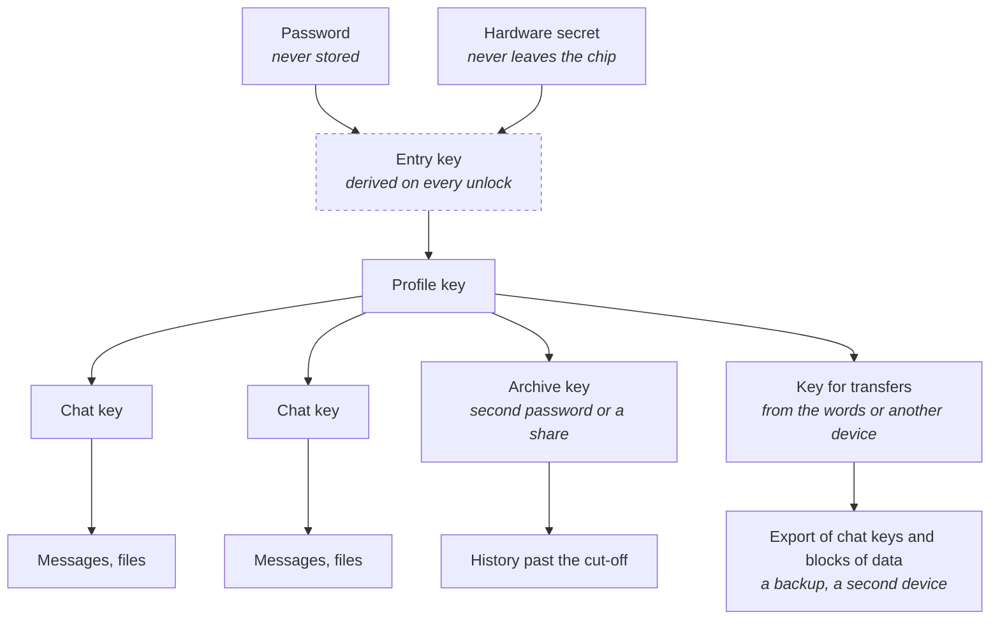

# LetheWis

A Rust library for the lifecycle of encryption keys on a device that may be taken from its owner:

- key derivation from a password, from a recovery phrase, and from a hardware secret;
- a key hierarchy with per-key state and versioning;
- destruction of a single key or of a whole profile;
- recovery independent of the hardware, and detection of a lost key;
- conditional access: key shares held by other people, and a time lock.

It is for applications where the device may be seized: wallets, password managers, notes, border
crossings, evidence collection.

What can be stated precisely is proven formally where possible. The rest is measured on real
devices and described as measured.

The core runs on any platform; without its `timelock` feature it needs no standard library or
allocator. Hardware binding is a crate per platform, Android first.

Suggestions for functionality not listed here are accepted as issues.

## How the keys relate

A key is never alone: each one opens only the level below it. Destroying one link makes everything
under it unreadable and leaves the rest untouched: deleting a chat destroys that chat's key, and
nothing else. The entry key is dashed because it is not stored anywhere: it is derived from the
password and the hardware secret at each unlock, and neither alone is enough.

## What is not guaranteed

- A destroyed key is gone only after the epoch change is committed and the hardware erases the old
  root. If that root survives or the hardware's keys leak, old records may still open.
- A key derived from a password, twelve words or two shares comes back from them. Destroying it
  does not reach them; destroying the profile key it opens does.
- An export outlives later changes on the device: its key for transfers opens it in any epoch. No
  export tells its age, so an older backup opens as a newer one does.
- A lock record left behind opens until the next change of epoch. Against someone who held that
  epoch's key and the record's secret, only a new profile key helps.
- A changed public key of an archive key is found only at its next load. Batches archived before
  that go to the changed key, and only someone who already reads those chats can change it.
- The archive keeps batches secret but does not prove where they came from. Against whoever holds
  the main password, their secrecy rests on the random source at archiving.
- A block of data or a batch shows its length; padding and the list of blocks are the caller's.
  An older block put back, or one deleted, goes unnoticed unless the caller's index catches it.
- A challenge to the chip is as sensitive as a hash of the password. Whoever reads one can test
  guesses without the chip; keeping it to the chip and wiping it is the caller's.
- Wiping does not reach copies left by a move, a reallocation or a register. Every call that
  derives, encrypts or runs X-Wing wipes its stack, measured on Linux.
- Memory outside `lethewis-locked`, and any memory off Linux and Android, may go to swap or a core
  dump. An Android app's process locks 64 KiB in all, in whole pages.
- A native crash on Android leaves a trace with memory near the crashing thread's registers. From
  API 31 the app reads it, and so may a crash reporter in it.
- The stack a call needs is not measured on microcontrollers, where an unguarded overflow corrupts
  memory silently. Each call documents the least it needs; a derivation from a password also needs
  64 MiB of memory.
- The cost of a derivation from a password is the caller's, past a floor of 64 MiB and 3 passes.
  So is bringing typed text into one Unicode form.
- A key handed out is the caller's to wipe. Only a key for external data leaves in the clear,
  through `Slots::reveal32`.
- Keys for wrapping and for transfers leave in the clear only as words, shares or a time lock made
  once. Keeping them is the caller's.
- A broken random source is covered in part, by hedging with the epoch key per RFC 8937. Not
  covered: an epoch key from that source, a copied process or machine, repeats across `Slots`, and
  password salts.
- Twelve words are as safe as the place they are kept: whoever reads them derives the key. Keeping
  them off screenshots, the clipboard and backups is the caller's.
- About one changed word in sixteen passes the checksum; the key it gives opens no record.
- A share with four or more wrong words may pass its check of three words. The check of the secret
  still refuses it, but for one time in 2^32.
- Any two holders of shares open what the shares protect, agreeing, forced or deceived. One alone
  learns nothing.
- A changed share is refused, not named. A 4-byte check split with the secret catches a change,
  except once in 2^32.
- Once its round is signed, a time lock opens for whoever holds it. Before then it keeps the owner
  out only if no other way in is left.
- If drand's network stops before a lock's round, the lock never opens. Enough of its members
  acting together can sign a round early.
- The time and the signature of a round are the caller's. A clock set back locks to a round already
  signed, which opens at once.
- A time lock rests on pairings, which a quantum computer breaks.
- A lock names its round openly: whoever holds it knows when it opens.
- A dedicated secure element is missing on a large share of Android devices, by our estimate.
  Android 9 offers none for this key; protection falls back and records the level it reached.
- A chip's key in secure hardware stops guesses from a copy of the flash; one only software holds
  does not. Code running as the app or as root asks the chip as the library does.
- A chip's key made below Android 15 answers on a locked device too, after an update as well. One
  made on 15 or later answers only while unlocked.
- On Android every challenge to the chip and its answer pass through the Java heap and the
  keystore's process. Copies the runtime makes there are beyond wiping.
- On Android a profile is made only under a directory named `no_backup`, as the one no backup of
  the system takes. Only the name is checked; a copy opens nothing without the device's keystore.
- On Android a deleted root is erased by best effort: no keystore confirms the overwrite. Apps
  cannot ask for keys that resist a rollback.
- A device unlocked since boot has its keys in memory already. No key-storage library changes
  that, and a lock screen is no defence against someone holding such a device.
- On Android `Keys` holds keys only on an unlocked device, while the app shows or runs its own
  foreground service. Without `Wiper.check` they stay up to two seconds after such a service ends.
- They stay as long after a lock that leaves the screen on. A screen the proximity sensor turns off,
  as in a call, counts as on.
- A call of `Keys` under way finishes before the wipe, and what calls take and return is not wiped.
  Past four seconds of it, a device whose screen went off may sleep before the wipe.
- An app the system freezes in the background keeps the keys of a call under way until it runs
  again.
- A password under duress opens its profile as the owner's does. Set to destroy, it deletes every
  other key of the library in the app's keystore.
- A locked profile opens only with a password of it and two shares, or its round's signature.
- Its ways copied before the lock, or their old bytes on the flash, open with the passwords of then.
- Either password opens it that way, and checks in to a time lock. So a lock tells one password
  from another no more.
- An unlock empties the way of the other password, which then reads as locked.
- A password that once opened the profile holds the key of its second factors. Setting, changing or
  removing a password draws that key anew.
- Those calls therefore make the shares anew, and the ones given before open no more. A time lock
  set refuses them until cleared, and is made again after.
- The way with a time lock is built with the `timelock` feature. When a missed check-in locks the
  profile is the app's to tell; the library keeps no clock.
- A lock that fails, as where the app's files cannot be written, leaves the profile open. The app is
  to enter it only once a lock succeeds.
- Judging the signs and locking need the chip's key, which from Android 15 answers only on an
  unlocked device. Code that reaches the chip tells whether a way in with a second factor is set.
- Code that reaches the chip reads what each sign watched does, and writes the file of the signs
  itself. Judging the signs needs no password, so neither does its key.
- A sign is judged when the app asks, so nothing happens while it does not run. The files of a
  profile are out of reach until the first unlock after a start.
- The key of the sign of the fingerprints needs a secure lock screen and a biometric strong enough
  enrolled. Without it the sign watches nothing, and `Profile::watch_fingerprints` tells why.
- Telling why needs the context `Wiper.start` gives; the sensor answers only with the app's
  permission `USE_BIOMETRIC`. Without them `Error::Unexplained` may come instead.
- Nothing here hides that a profile exists: its directory shows.
- A destroying entry takes longer by the deletion of the keys. The keystore's database shows the
  deletion to whoever compares images of it.
- Whoever holds the device and a password learns what that password opens, of each one typed.
- Two images of the ways show which way changed, and so the kind of change, not what one opens.
- A proof is about one named statement, not about safety. Each claim names the tool, its version,
  the assumptions and what is not covered, and never says "formally verified" alone.

The full statement of what is and is not defended, with the assumptions behind each:
[docs/threat-model.md](docs/threat-model.md).

## Crates

Split along the boundary of what is proven: anything that reaches the system or the network is a
separate crate, so the proof perimeter is visible from the directory listing.

| Crate | Contents |
|---|---|
| `lethewis-core` | keys from derivation to destruction, two-tier access, shares, time locks with `timelock`, data in blocks; the system only through `lethewis-dit` |
| `lethewis-dit` | data-independent timing on aarch64 where Linux, Android or an Apple system reports it; unsafe code |
| `lethewis-timelock` | keys locked until a round of drand's quicknet, as age files `tle` opens; no network or clock |
| `lethewis-android` | profiles on Android: the chip's answer to the core's challenge, roots of epochs, keys held while the app shows |
| `lethewis-jni` | the bridge to the Java layer in `android/`, through JNI; unsafe code |
| `lethewis-locked` | memory locked in RAM, out of core dumps and forks, on Linux and Android; unsafe code |

Claimed and proven properties: [docs/proofs.md](docs/proofs.md).

Minimum supported Rust version: 1.99, as declared in the manifest; newer compilers work. A raise is
recorded in [CHANGELOG.md](CHANGELOG.md).

This repository builds with exactly 1.99.0, pinned in `rust-toolchain.toml` so that builds reproduce
byte for byte. The pin is not part of the published package.

How dependencies are reviewed, and which versions a dependent receives:
[SECURITY.md](SECURITY.md#dependencies).

## Reporting and contributing

Report a security problem through the private advisory form, not as a public issue. Terms and
timings are in [SECURITY.md](SECURITY.md).

Bugs, problems with a proof and requests for functionality go in issues. A property that does not
hold is the most useful report this project can get.

Code is not accepted yet, for the reasons in [CONTRIBUTING.md](CONTRIBUTING.md); describe the fix in
an issue instead. The code of conduct is in [CODE_OF_CONDUCT.md](CODE_OF_CONDUCT.md).

## Licence

[GNU AGPL v3 only](LICENSE). The English word list of BIP 39 in
`crates/lethewis-core/src/words/english.txt` is under the
[MIT licence](crates/lethewis-core/LICENSE-MIT), and its notice goes with any build that holds it.

A commercial licence without the AGPL's obligations is available from <hi@alanwisper.com>.
